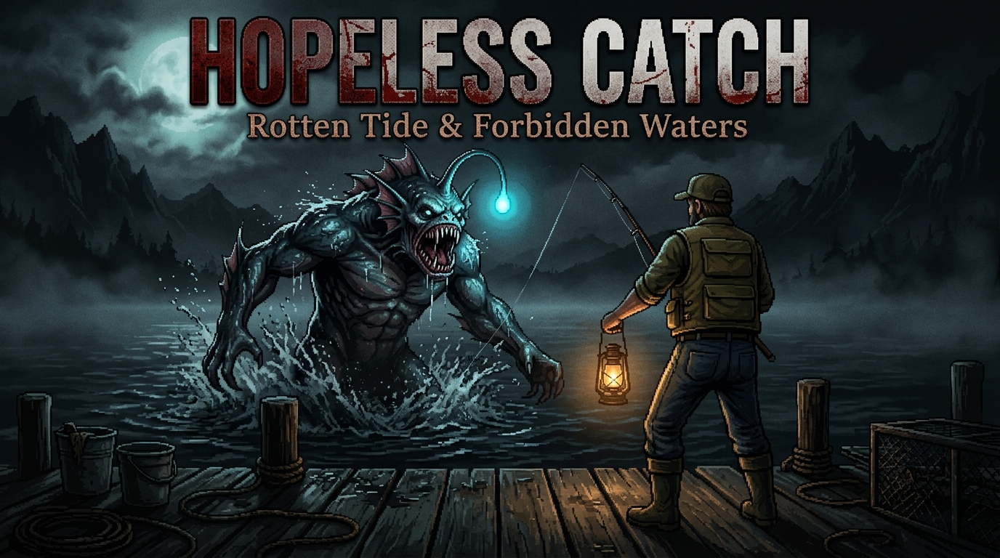

<div align="center">
  

  [](https://mungdaal321.itch.io/hopeless-catch)
  [](https://love2d.org)
  [](https://mungdaal321.itch.io/hopeless-catch)

  # HOPELESS CATCH
  ### *Rotten Tide & Forbidden Waters*
  *A Psychological Fishing Horror Game built with LÖVE 11.5*
</div>

---

## 🎣 Game Jam Pitch & Vision
> *"Every fisherman has a reason they cast their line into the dark. Some seek sustenance. Some seek solitude. But out here, in the cursed black water of Lake Acheron, you are not fishing for what swims in the shallows... you are fishing to satisfy the Rotten Tide before it pulls you under."*

**Hopeless Catch** is a psychological horror game where deep, tension-based fishing is the uncompromising core mechanic. By combining retro visual layering, atmospheric soundscapes, dynamic day-to-night dread, and the secret jam themes (**Forbidden Waters** & **Rotten Tide**), the game pulls the player into an eerie cycle of obsession, strange bait, unholy catches, and escalating madness.

---

## 🌊 Secret Themes Integration

### 1. **Forbidden Waters**
- The lake is divided into depth zones: **The Shallows**, **The Drop-off**, and **The Trench (Forbidden Waters)**.
- Venturing out onto the dock at midnight or casting beyond the warning buoys triggers the *Forbidden Waters* state:
  - The ambient color grades shift to a sickly greenish-black.
  - Screen distortion, creeping vignettes, and auditory hallucinations kick in.
  - You can hook eldritch abominations that fight with erratic, aggressive behavior, whispering strange text across the screen.

### 2. **Rotten Tide**
- Each day, the tide rises with necrotic muck and foul detritus.
- As the Rotten Tide level increases across the week:
  - Common fish develop necrotic mutations (tumors, extra eyes, weeping gills).
  - Normal baits rot into vile variants (Maggot Clusters, Carrion Chunks, Cursed Bile).
  - The player's sanity degrades the longer a cursed catch stays thrashing on the line.

---

## 🕹️ Core Game Loop

```
[Start Up / Warning Screen] 
         │
         ▼
[Atmospheric Title Menu]
         │
         ▼
[Cabin / Shore Gameplay] ◄────────────────────────────────────────┐
         │                                                        │
         ▼                                                        │
[Choose Bait & Cast Line into Lake]                               │
         │                                                        │
         ▼                                                        │
[Wait in Silence & Tension (Bite Alert)]                          │
         │                                                        │
         ▼                                                        │
[Reel Struggle & Line Tension Battle]                             │
    ├──► If Line Snaps: Sanity Loss / Lake Reaction ──────────────┤
    └──► If Caught: Reveal Catch & Log Journal Narrative          │
         │                                                        │
         ▼                                                        │
[Night Arrives / Rotten Tide Escalates / Rest in Cabin] ──────────┘
```

1. **Prepare**: Manage your Tackle Box, inspect bait potency, and read the Field Journal for cryptic hints.
2. **Explore the Shore**: Move along the dock and shoreline (WASD). Position yourself relative to shadows, ripples, and water depths.
3. **Cast (Power & Trajectory)**: Charge casting power with `SPACE`. Aim for calm water, ominous ripples, or the Forbidden Trench.
4. **The Waiting Horror**: Complete quiet. Wind howling, wooden dock creaking, subtle ripples forming. An abrupt jerk on the bobber tests player reflexes.
5. **The Reel Struggle (Mini-game)**:
   - Line tension gauge with danger zones.
   - Fish stamina and sudden desperate surges.
   - If line snaps, you lose your bait and invite an ominous lake reaction.
6. **The Revelation**: Inspect what you hauled from the abyss with custom pixel art, weight, rarity, and unsettling field notes.
7. **Survive the Cycle**: Sell or sacrifice catches to stave off the Rotten Tide, rest in your dilapidated cabin, and uncover the truth behind the lake.

---

## 🎨 Rendering Architecture & Visual Layering

The game uses a strict multi-layer render stack to guarantee cinematic depth and retro horror atmosphere:

| Layer # | System / Component | Description |
| :--- | :--- | :--- |
| **Layer 0** | **Skybox & Celestial Bodies** | Dynamic time-of-day sky gradient, celestial sun/moon, stars, drifting storm clouds. |
| **Layer 1** | **Distant Background** | Parallax mountains, silhouettes of dead pine trees, eerie distant fog banks. |
| **Layer 2** | **Midground Terrain** | Shoreline grass, dilapidated cabin with glowing window, wooden dock planks. |
| **Layer 3** | **Water & Lake Surface** | Multi-depth water shader with procedural sine-wave ripples, floating debris, and eerie underwater shadows. |
| **Layer 4** | **Entities & Gameplay** | Player character, fishing rod, bobber, splash particle emitters, and tackle effects. |
| **Layer 5** | **Lighting & Day/Night Pass** | Ambient color grading, lantern light halos with flicker, darkness vignette. |
| **Layer 6** | **Atmospheric & Weather FX** | Rain streaks, dense creeping fog layers, lightning flashes, floating pollen/spores. |
| **Layer 7** | **Post-Processing / Shaders** | VHS / CRT chromatic aberration, vignette, water distortion, screen shake. |
| **Layer 8** | **UI / HUD & Overlays** | ImGui / custom canvas retro UI: Day/Clock, Tension HUD, Tackle Box, Journal, Catch Display. |

---

## 🗺️ State Machine Flow

1. **Splash / Boot Screen**:
   - Disturbing content warning: *"This game contains psychological dread, body horror, and deep water themes."*
   - Audio crackle & studio tag.
2. **Start Menu**:
   - Living cinematic backdrop (lake ripples, foggy rain, moonlight glinting off water).
   - High-contrast horror typography, custom audio hum.
   - Options: *Begin Fishing, How to Fish, Secrets/Journal, Settings, Quit*.
3. **Gameplay**:
   - Free movement, rod casting, reeling battle, day/night cycle, cabin sleep, horror encounters.
4. **Pause Menu (`ESC`)**:
   - Dark translucent frosted overlay that keeps the frozen gameplay visible.
   - Quick resume, controls reference, volume controls, return to main menu.
5. **Journal / Tackle Overlays (`TAB` / `B`)**:
   - Retro field book aesthetic with caught fish logs, cryptic day entries, and bait slots.

---

## 📂 Enterprise Architecture & Directory Structure

```text
HopelessCatch_Source/
├── conf.lua                  -- Engine window, resolution & module settings
├── main.lua                  -- High-level game lifecycle & state delegation
├── assets/                   -- Raw audio, sprite art, and fonts
│   ├── audio/                -- Ambient hums, splashes, reel clicks, stingers
│   ├── fish/                 -- 9 unique fish species sprites
│   └── bait/                 -- Worms, minnows, corn, cheese, rotten variants
├── src/
│   ├── core/                 -- Engine abstractions & utilities
│   │   ├── statemachine.lua  -- Robust pushdown state machine
│   │   ├── input.lua         -- Action-mapped input manager
│   │   ├── assets.lua        -- Asset loader, sprite manager & sound engine
│   │   ├── save.lua          -- JSON/Lua save & progression serialization
│   │   └── camera.lua        -- Smooth following camera with trauma-based shake
│   ├── states/               -- Discrete game states
│   │   ├── splashstate.lua   -- Warning & logo sequence
│   │   ├── menustate.lua     -- Living main menu with options
│   │   ├── playstate.lua     -- Main fishing gameplay loop
│   │   └── pausestate.lua    -- Pause menu modal overlay
│   ├── entities/             -- In-game interactables
│   │   ├── player.lua        -- Fisherman movement, facing & animations
│   │   ├── rod.lua           -- Line physics, bezier curves & bobber simulation
│   │   └── lakeelements.lua  -- Floating logs, eerie eyes, bubbles & fish silhouettes
│   ├── systems/              -- Core simulation mechanics
│   │   ├── fishingsystem.lua -- Cast power, bite RNG, line tension, reel struggle
│   │   ├── daynight.lua      -- 24-hour cycle, daylight interpolation, phases
│   │   ├── weather.lua       -- Clear, Fog, Rain, Storm, Rotten Tide
│   │   └── horrorevents.lua  -- Hallucinations, sky anomalies, the Fishman
│   ├── world/                -- Multi-layered environment rendering
│   │   ├── skyrenderer.lua   -- Gradients, sun, moon, stars, clouds
│   │   ├── terrain.lua       -- Shore, grass, dock, cabin
│   │   ├── water.lua         -- Procedural wave layers & underwater shadows
│   │   └── lighting.lua      -- Dark ambient multiply pass & lantern bloom
│   ├── ui/                   -- Clean HUD, Journal & Dialogs
│   │   ├── hud.lua           -- Clock, weather, line tension, cast bar
│   │   ├── journal.lua       -- Field journal with sketch entries & lore
│   │   ├── tacklebox.lua     -- Bait selection grid & descriptions
│   │   └── catchdisplay.lua  -- Dramatic catch reveal modal
│   └── data/                 -- Pure data tables & configs
│       ├── fishdata.lua      -- Species rarity, struggle patterns, lore
│       └── baitdata.lua      -- Bait affinities, rotten tide transformations
└── cimgui/                   -- ImGui bindings & native wrappers
```

---

## 🚀 Multi-Platform Packaging & Itch.io Butler Publishing

Hopeless Catch is deployed across three channels on itch.io:
1. **`html5`**: Playable directly in modern web browsers (Emscripten / love.js 11.4).
2. **`windows`**: Standalone 64-bit executable fused with LÖVE 11.5 + SDL2/OpenAL runtime DLLs.
3. **`love`**: Universal `.love` file for macOS, Linux, Steam Deck, or custom LÖVE installs.

### 📦 1. Build All Formats

From PowerShell in `HopelessCatch_Source`:

```powershell
# 1. Package the universal .love file
if (Test-Path '..\dist\love') { Remove-Item -Recurse -Force '..\dist\love' }
New-Item -ItemType Directory -Force '..\dist\love'
Compress-Archive -Path * -DestinationPath '..\dist\love\HopelessCatch.zip' -Force
Move-Item -Force '..\dist\love\HopelessCatch.zip' '..\dist\love\HopelessCatch.love'

# 2. Fuse the Windows Standalone Executable
cmd /c copy /b /y 'C:\Love2D\love-11.5-win64\love.exe' + '..\dist\love\HopelessCatch.love' '..\dist\windows\HopelessCatch.exe'

# 3. Synchronize Web Port Data & Emscripten Byte Offsets
Copy-Item -Force '..\dist\love\HopelessCatch.love' '..\..\Love2d_Web\dist\game.data'

# Synchronize exact package bytes in game.js (prevents Emscripten startup errors)
node -e "const fs = require('fs'); const path = require('path'); const dataPath = path.resolve('../../Love2d_Web/dist/game.data'); const jsPath = path.resolve('../../Love2d_Web/dist/game.js'); const len = fs.statSync(dataPath).size; let js = fs.readFileSync(jsPath, 'utf8'); js = js.replace(/\"remote_package_size\":\d+/, '\"remote_package_size\":' + len); js = js.replace(/\"end\":\d+/, '\"end\":' + len); fs.writeFileSync(jsPath, js, 'utf8'); console.log('Synced game.js to length:', len);"
```

> [!IMPORTANT]
> **Web Port Compatibility**: Keep `t.version = "11.4"` in `conf.lua`. This avoids the browser compatibility warning dialog while preserving full compatibility across both LÖVE 11.4 and 11.5.

---

### 🚢 2. Push to Itch.io via Butler CLI

Using your authenticated Butler executable (e.g. `C:\Users\MungDaal321\Downloads\butler-windows-amd64\butler.exe`):

```powershell
$BUTLER = "C:\Users\MungDaal321\Downloads\butler-windows-amd64\butler.exe"
$TARGET = "mungdaal321/hopeless-catch"
$VERSION = "1.0.3"

# Upload Web Build
& $BUTLER push "..\..\Love2d_Web\dist" "$TARGET:html5" --userversion $VERSION

# Upload Windows Build
& $BUTLER push "..\dist\windows" "$TARGET:windows" --userversion $VERSION

# Upload .love Universal File
& $BUTLER push "..\dist\love" "$TARGET:love" --userversion $VERSION

# Check Status
& $BUTLER status $TARGET
```

---

### ⚙️ 3. Itch.io Page Settings Reference

* **Kind of Project**: `HTML`
* **Embed Options**: `Embed in page`
* **Viewport Dimensions**: `1280` px × `720` px (16:9 widescreen)
* **Orientation**: `Default` or `Landscape`
* **Fullscreen Button**: `Checked`
* **Enable Scrollbars**: `Unchecked`
* **SharedArrayBuffer Support**: `Unchecked`
* **Files Configuration**:
  - `html5`: Mark with **"This file will be played in the browser"**
  - `windows`: Mark with the **Windows** platform icon
  - `love`: Available as direct download for all platforms

